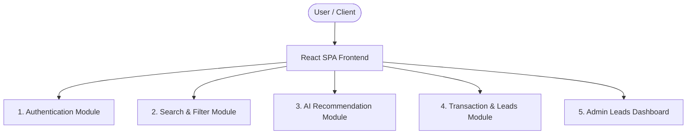

# Project Chapter 1: Project Synopsis

## 1. Project Title
**CarSaathi: Used Car Portal & AI Recommendation Engine**

---

## 2. Introduction & Problem Statement
In the current automotive resale market, users find it challenging to navigate through multiple unstructured price ranges, search for models with typos, and find appropriate vehicle recommendations that suit their specific lifestyle needs. Popular platforms offer rigid filters but fail to understand natural language intent (e.g., *"I need a safe family SUV under 15 Lakh for road trips"*).

Furthermore, from a technical perspective, building high-availability applications that rely heavily on third-party services (like Elasticsearch, Redis, and Generative AI APIs) poses a risk. If these dependencies fail, the entire system can crash. 

**CarSaathi** solves these issues by:
1. Providing an intuitive portal interface to filter, list, delete, and book test drives.
2. Integrating a custom **Indian Currency (Lakh/Crore) Price Parser** that converts phrases like "5 Lakh" or "1.2 Cr to 1.5 Cr" into computer-readable numbers.
3. Leveraging **Generative AI (Google Gemini API)** to provide personalized, context-aware car recommendations in real-time.
4. Implementing a **resilient hybrid search architecture** that automatically falls back to PostgreSQL Full-Text Search (FTS) if Elasticsearch goes offline, and falls back to a custom in-memory scoring engine if Redis or Gemini API keys are missing.

---

## 3. Project Objectives
*   **Intelligent Search**: Provide a typo-tolerant fuzzy search experience for used cars.
*   **Natural Language Recommendations**: Create an AI assistant that behaves like a digital car consultant.
*   **Robust Fallback Mechanisms**: Architect the system to maintain service availability even if Elasticsearch, Redis, or the Gemini API are disconnected.
*   **Role-Based Security**: Secure operations (like listing new cars or deleting listings) through JSON Web Tokens (JWT) based on user roles (Customer, Dealer, Admin).
*   **Indian Price Localization**: Parse complex price ranges and represent currency values in the standard Indian numbering format (Lakhs/Crores).
*   **Admin Command Center**: Provide a unified dashboard for administrators to view leads (test drive bookings, service schedules, loan requests, and new car leads).

---

## 4. Key Functional Modules

### 4.1. Authentication & Authorization Module
*   Supports user registration and login with roles: **Customer**, **Dealer**, and **Admin**.
*   Secures requests using state-of-the-art stateless JWT authorization.
*   Includes simulated **One-Time Password (OTP)** generation and validation via Redis cache with a 5-minute expiration time.

### 4.2. Search & Filter Module
*   Allows searching cars by brand, model, city, and price range.
*   Includes **advanced sidebar filters** for refining search results by Car Age (manufacturing year), Fuel Type (Petrol, Diesel, Electric), Kilometers Driven (odometer ranges), Transmission (Manual, Automatic), and Exterior Colour.
*   Applies a custom price phrase parser to process human terms (e.g., `5 to 8 Lakh`) into SQL-compatible number ranges.
*   Uses **Elasticsearch** multi-match query with fuzzy auto-tuning, falling back to a PostgreSQL `tsvector` query with an indexed GIN index for performance.

### 4.3. AI Car Recommendation Module
*   Takes user parameters (budget, driving purpose, fuel type, body type, priorities, and a custom text prompt).
*   Injects matching vehicle data into the **Google Gemini API** (`gemini-3.1-flash-lite`) prompt.
*   Extracts structured JSON containing recommendations, match percentages, and customized justifications.
*   Includes a fallback local rule-based match engine.

### 4.4. Transaction & Booking Modules
*   **Test Drive Scheduler**: Allows booking a test drive for a specific car, specifying name, phone, date, and slot.
*   **Loan Calculator & Application**: Divided into separate full-width interactive views for EMI/Interest Rate Calculation and Loan Application. Assesses applicant credit rating, monthly income, and loan parameters, auto-determining approval status. Includes:
    *   **Eligibility Checker**: Dynamic debt-to-income calculator assessing credit borrowing capacity.
    *   **Offers Comparison Matrix**: Side-by-side comparison matrix of interest rates and terms across partner banks (SBI, HDFC, ICICI, Axis).
    *   **Required Documents**: Detailed document lists for salaried and self-employed applicants.
    *   **Loan FAQs**: Interactive accordion-style used-car financing FAQs.
    *   **Track Application**: Multi-stage progress tracking workflow (Form Submission, Bureau Pull, Doc Verification, and Disbursal).
*   **New Car Leads**: Captures buyer interest in new models. Includes:
    *   **Explore New & Upcoming Cars**: Grid displaying details, launch dates, and specifications of upcoming vehicles.
    *   **Latest Launches**: Timeline showcasing newly launched models with prices and descriptions.
    *   **Compare New Cars**: Side-by-side technical specification comparison table.
    *   **Book Test Drive**: Priority slot scheduler form for brand new car test drives.
    *   **Download Brochure**: Download client model brochures with live success toast triggers.
    *   **Submit Inquiry**: General interest/lead registration portal for custom model specifications.
    *   **New Car Offers**: Renders cash discounts, exchange bonuses, and promotional benefits.
*   **Service Center Scheduler**: Books vehicle maintenance slots and manages additional user services. Includes:
    *   **Book Car Service**: General periodic service packaging and booking form scheduler.
    *   **Insurance Renewal**: Simulated premium calculator and policy payment confirmation system.
    *   **Car Inspection**: Doorstep engineer evaluations.
    *   **Car Wash**: Detailing packages and deep-clean booking scheduler.
    *   **Tyre & Battery Services**: Wheel alignment and tyre service packages.
    *   **Roadside Assistance**: Dispatch center for flat tyres, towing, jumpstarts, and fuel delivery.
    *   **Service History**: Personal workshop and maintenance log tracker.
    *   **Find Nearby Service Centers**: Workshop address locator sorted by user cities.
*   **Request Callback**: Allows users to input their mobile number, select their language, and submit a question/issue to schedule a representative call.
*   **Free Car Valuation**: Dynamic in-browser calculator estimating vehicle resale values based on brand, age, condition, and mileage.
*   **Book Inspection**: home-based vehicle engineering evaluation scheduler for certified pre-listing checks.
*   **My Listings**: Filtered repository segment rendering only the active used car catalog items submitted by the authenticated dealer.
*   **Track Listing Status**: Visual workflow tracking wizard detailing stages (Submission, Home Inspection, Report Generation, and live publication).
*   **Selling Tips**: Interactive guide detailing preparation checklist strategies to maximize used car resale values.

### 4.5. Admin Command Center Dashboard
*   Restricts access exclusively to users with the `Admin` role.
*   Aggregates live leads across bookings, service schedules, loan applications, and new car leads.

---

## 5. Technical Scope & Educational Value
For an academic examiner, the CarSaathi repository showcases:
1.  **Monorepo Workspaces**: Standard industry setup using npm workspaces to share utilities (like currency formatter test suites) between client and server.
2.  **Graceful Degradation Design**: Fallback designs for search indices, cache layers, and AI models to guarantee high availability.
3.  **Modern Database Indexing**: GIN indices on generated search vector columns in PostgreSQL, showcasing deep database optimization knowledge.
4.  **Secure Web API Design**: Implementing strict rate limiters, Helmet CSP configurations, CORS controls, and password hashing (`bcrypt`).
