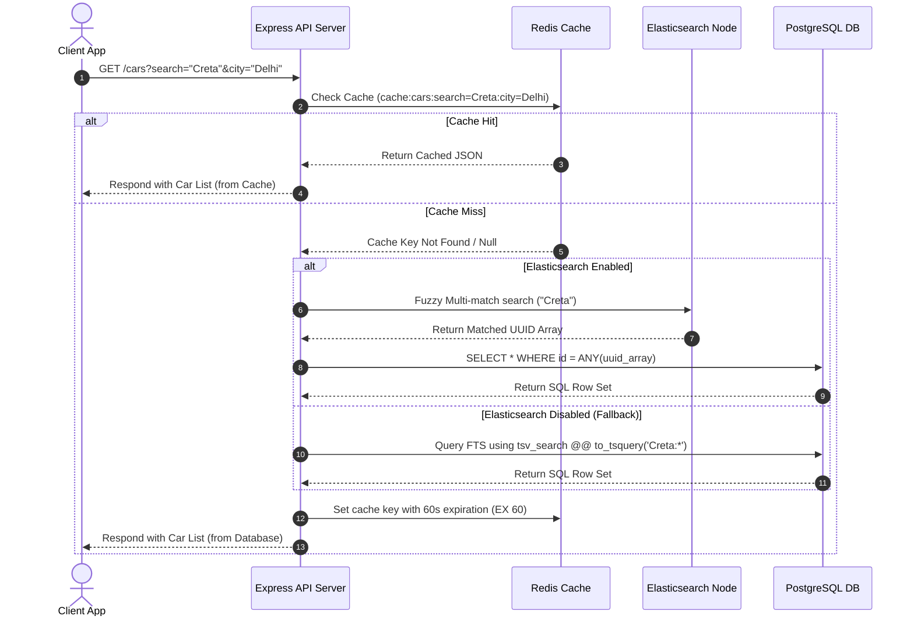
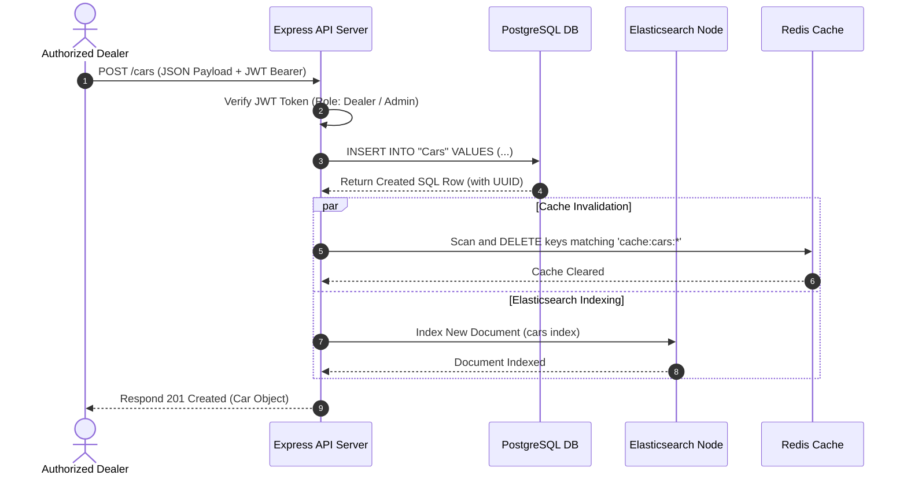

# Project Chapter 2: System Architecture & Design

## 1. Architectural Style
CarSaathi uses a decoupled **Three-Tier Architecture** packaged in a single-repository monorepo workspace. Communication between the frontend React application and the Express API server takes place statelessly via JSON over HTTP REST endpoints.

```
       +---------------------------------------+
       |         React.js (Vite) Frontend      |  [Client Tier]
       +-------------------+-------------------+
                           |
                     HTTP  |  REST Requests
                           v
       +-------------------+-------------------+
       |        Express.js TypeScript Server   |  [Application Tier]
       +----+--------------+---------------+---+
            |              |               |
            | SQL          | Cache Reads   | HTTP POST (Gemini API)
            v              v               v
   +--------+---+    +-----+------+   +----+-------+
   | PostgreSQL |    | Redis Cache|   | Google AI  |  [Data / Service Tier]
   |  Database  |    |  Cluster   |   |   Gemini   |
   +--------+---+    +-----+------+   +------------+
            ^              ^
            | Search Sync  |
            v              |
     +------+-------+      |
     | Elasticsearch|------+ [Cache Invalidation Loop]
     +--------------+
```

---

## 2. High-Availability Fallback Designs
A key engineering achievement of this project is its **resilience**. The backend automatically detects service outages and switches to local fallbacks to ensure zero downtime.

### 2.1. Search Failover: Elasticsearch &rarr; PostgreSQL Full-Text Search
1.  **Ideal State**: When search queries are received, the server queries the local Elasticsearch node using a fuzzy multi-match query on fields `make^2`, `model^2`, and `city`.
2.  **Fallback State**: If the Elasticsearch client connection times out or errors during initialization, the server disables the Elasticsearch flag and routes search queries directly to PostgreSQL.
3.  **Database FTS Execution**: PostgreSQL processes searches using a generated `tsvector` column (`tsv_search`) indexed with a GIN index:
    ```sql
    tsv_search @@ to_tsquery('english', 'search_query:*')
    ```

### 2.2. Caching Failover: Redis &rarr; Memory Map
1.  **Ideal State**: All searches, rate-limit keys, and session verification OTPs are stored in the Redis instance.
2.  **Fallback State**: If Redis is unavailable, the application instantiates a mock `MemoryRedisClient`. This class implements the `IRedisClient` interface using a standard JavaScript `Map` with custom timestamp-based TTL (Time-To-Live) tracking and pattern key matching (via converted regular expressions).

### 2.3. AI Recommendations Failover: Gemini API &rarr; Local Rule Engine
1.  **Ideal State**: The server constructs a prompt containing the user’s budget, car type preferences, and a JSON list of available cars, and sends a REST request to the Gemini API (`gemini-3.1-flash-lite`).
2.  **Fallback State**: If the `GEMINI_API_KEY` is not provided, or the network request fails, the backend switches to a local heuristic matching engine. This engine scores the database entries using:
    *   Budget match (+10/-40 based on deviation).
    *   Fuel type and body type matching (+15/-20).
    *   Text similarity parsing (+30 for exact brand/model match, +10 for keyword triggers).
    *   It ranks the listings and generates natural-sounding justifications dynamically.

---

## 3. Workflow Diagrams

### 3.1. Car Search & Caching Workflow
Shows how cache matches are served and how DB results are cached.



### 3.2. Car Listing & Cache Invalidation Workflow
Demonstrates how cache consistency is maintained by invalidating caching patterns on updates.


