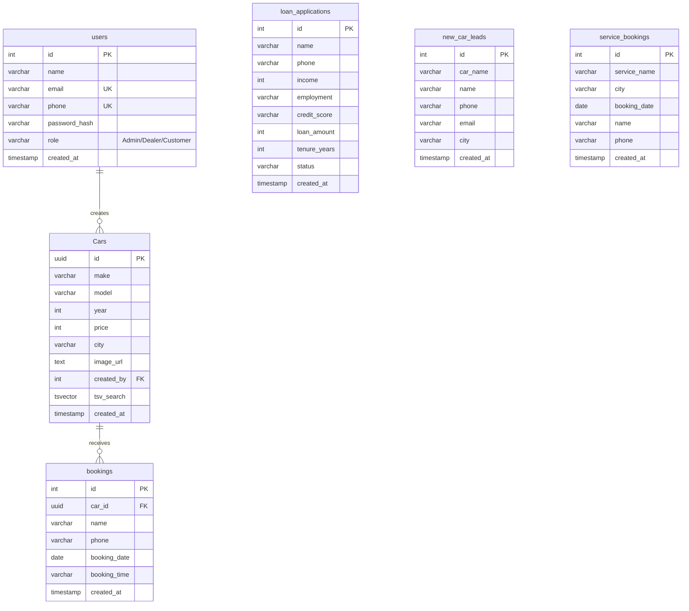

# Project Chapter 3: Database Schema & Index Design

## 1. Entity-Relationship Diagram (ERD)

The database schema is implemented in **PostgreSQL**. The diagram below details the tables and their relations:



---

## 2. Table Specifications

### 2.1. Table: `users`
Stores user authentication details and access roles.

| Column | Data Type | Constraints | Default | Description |
| :--- | :--- | :--- | :--- | :--- |
| `id` | `SERIAL` | `PRIMARY KEY` | *Auto-increment* | Unique identifier for the user. |
| `name` | `VARCHAR(100)`| `NOT NULL` | | Full name of the user. |
| `email` | `VARCHAR(150)`| `NOT NULL`, `UNIQUE` | | User email used for login. |
| `phone` | `VARCHAR(20)` | `NOT NULL`, `UNIQUE` | | Mobile number for OTP verification. |
| `password_hash`| `VARCHAR(255)`| `NOT NULL` | | Salted Bcrypt password hash. |
| `role` | `VARCHAR(20)` | | `'Customer'` | Access permissions: `'Admin'`, `'Dealer'`, `'Customer'`. |
| `created_at` | `TIMESTAMP` | | `CURRENT_TIMESTAMP` | Date of registration. |

### 2.2. Table: `Cars`
Stores details of listed preowned cars.

| Column | Data Type | Constraints | Default | Description |
| :--- | :--- | :--- | :--- | :--- |
| `id` | `UUID` | `PRIMARY KEY` | `gen_random_uuid()` | Universally Unique ID for listings. |
| `make` | `VARCHAR(100)`| `NOT NULL` | | Brand name (e.g., Maruti Suzuki). |
| `model` | `VARCHAR(100)`| `NOT NULL` | | Model name (e.g., Swift). |
| `year` | `INT` | `NOT NULL` | | Manufacturing year. |
| `price` | `INT` | `NOT NULL` | | Listing price in INR. |
| `city` | `VARCHAR(100)`| `NOT NULL` | | City where the car is located. |
| `image_url` | `TEXT` | | | Link to the car image. |
| `created_by` | `INT` | `FOREIGN KEY` references `users(id)` | `NULL` | Link to user who listed the car. |
| `tsv_search` | `TSVECTOR` | `GENERATED ALWAYS` | | Combined search vector. |
| `created_at` | `TIMESTAMP` | | `CURRENT_TIMESTAMP` | Date of creation. |

### 2.3. Table: `bookings`
Stores test-drive appointment bookings.

| Column | Data Type | Constraints | Default | Description |
| :--- | :--- | :--- | :--- | :--- |
| `id` | `SERIAL` | `PRIMARY KEY` | *Auto-increment* | Unique booking reference ID. |
| `car_id` | `UUID` | `FOREIGN KEY` references `Cars(id)` ON DELETE CASCADE | | ID of the test-drive car. |
| `name` | `VARCHAR(100)`| `NOT NULL` | | Name of the booker. |
| `phone` | `VARCHAR(20)` | `NOT NULL` | | Contact phone number. |
| `booking_date`| `DATE` | `NOT NULL` | | Date scheduled for test drive. |
| `booking_time`| `VARCHAR(20)` | `NOT NULL` | | Time slot chosen. |
| `created_at` | `TIMESTAMP` | | `CURRENT_TIMESTAMP` | Lead generation date. |

### 2.4. Table: `loan_applications`
Captures user submissions for financing and loan inquiries.

| Column | Data Type | Constraints | Default | Description |
| :--- | :--- | :--- | :--- | :--- |
| `id` | `SERIAL` | `PRIMARY KEY` | *Auto-increment* | Application reference number. |
| `name` | `VARCHAR(100)`| `NOT NULL` | | Full name of applicant. |
| `phone` | `VARCHAR(20)` | `NOT NULL` | | Contact number. |
| `income` | `INT` | `NOT NULL` | | Monthly income in INR. |
| `employment` | `VARCHAR(50)` | `NOT NULL` | | e.g. "Salaried" or "Self-Employed". |
| `credit_score`| `VARCHAR(50)` | `NOT NULL` | | e.g., "750+" or "650-700". |
| `loan_amount` | `INT` | `NOT NULL` | | Requested loan amount in INR. |
| `tenure_years`| `INT` | `NOT NULL` | | Tenure in years. |
| `status` | `VARCHAR(50)` | | `'Pending Approval'`| Auto-evaluated approval status. |
| `created_at` | `TIMESTAMP` | | `CURRENT_TIMESTAMP` | Application submission time. |

### 2.5. Table: `new_car_leads`
Captures client interest in upcoming or brand new cars.

| Column | Data Type | Constraints | Default | Description |
| :--- | :--- | :--- | :--- | :--- |
| `id` | `SERIAL` | `PRIMARY KEY` | *Auto-increment* | Lead reference number. |
| `car_name` | `VARCHAR(100)`| `NOT NULL` | | Name of the new car. |
| `name` | `VARCHAR(100)`| `NOT NULL` | | Customer name. |
| `phone` | `VARCHAR(20)` | `NOT NULL` | | Customer phone number. |
| `email` | `VARCHAR(150)`| `NOT NULL` | | Customer email. |
| `city` | `VARCHAR(100)`| `NOT NULL` | | Preferred location. |
| `created_at` | `TIMESTAMP` | | `CURRENT_TIMESTAMP` | Lead time. |

### 2.6. Table: `service_bookings`
Stores car servicing scheduler records.

| Column | Data Type | Constraints | Default | Description |
| :--- | :--- | :--- | :--- | :--- |
| `id` | `SERIAL` | `PRIMARY KEY` | *Auto-increment* | Service record ID. |
| `service_name`| `VARCHAR(100)`| `NOT NULL` | | Type of service required. |
| `city` | `VARCHAR(100)`| `NOT NULL` | | Booking service center city. |
| `booking_date`| `DATE` | `NOT NULL` | | Planned booking date. |
| `name` | `VARCHAR(100)`| `NOT NULL` | | Customer name. |
| `phone` | `VARCHAR(20)` | `NOT NULL` | | Customer mobile. |
| `created_at` | `TIMESTAMP` | | `CURRENT_TIMESTAMP` | Record timestamp. |

---

## 3. SQL Optimization & Full-Text Search Indices
To speed up keyword searches without Elasticsearch, PostgreSQL is optimized using a generated `tsvector` column. It computes lexemes automatically and weights search terms by relevance (e.g., Make is weighted highest as 'A', Model as 'B', City as 'C', and Year as 'D'):

```sql
ALTER TABLE "Cars" ADD COLUMN tsv_search tsvector GENERATED ALWAYS AS (
  setweight(to_tsvector('english', coalesce(make, '')), 'A') ||
  setweight(to_tsvector('english', coalesce(model, '')), 'B') ||
  setweight(to_tsvector('english', coalesce(city, '')), 'C') ||
  setweight(to_tsvector('english', coalesce(year::text, '')), 'D')
) STORED;
```

### 3.1. Index Creation
To query this column efficiently, a Generalized Inverted Index (GIN) is created:
```sql
CREATE INDEX cars_tsv_idx ON "Cars" USING gin(tsv_search);
```
*   **Why GIN?**: Unlike standard B-Tree indices that index full column values, GIN indexes split sentences into single words (lexemes) and point to their matching rows, reducing multi-word search overhead from $O(N)$ scans to $O(1)$ lookups.
